# ARCHITECTURE
## ML-Based Liquidity and Trading-Risk Intelligence for Indian Equities

**Version:** 2.0  
**Status:** Comprehensive End-to-End System Architecture (Phases 1–5 Complete; Phase 6 EDA Next)  
**Last Updated:** November 2026  

---

## 1. End-to-End System Architecture Diagram

The system operates across six logical layers, from external market feeds to the multi-page risk intelligence dashboard. Completed components are visually distinguished from planned components. Supervised risk modeling (`HRE_5d` prediction) and unsupervised historical anomaly detection (`IsolationForest`) execute as two separate, decoupled modeling branches whose outputs converge at the risk-intelligence and dashboard layer.

```mermaid
flowchart TD
    %% ==========================================
    %% TOP EXTERNAL SOURCES & CONFIGURATION LAYER
    %% ==========================================
    subgraph SOURCES["1. External Market Feeds & Configuration [IMPLEMENTED]"]
        direction LR
        SRC_YAHOO["Yahoo Finance API (yfinance)\n300 NSE Stocks (.NS)\n^NSEI (Nifty 50) | ^INDIAVIX\n(^NSEBANK reserved)"]
        SRC_CONFIGS["Configuration Layer (configs/)\nuniverse.json | pipeline_config.yaml\nfeature_config.yaml | model_config.yaml\ndashboard_config.yaml"]
    end

    %% ==========================================
    %% LAYER 1: DATA ACQUISITION & VALIDATION
    %% ==========================================
    subgraph L1["Layer 1: Data Acquisition, Validation & Storage [IMPLEMENTED]"]
        direction TB
        L1_UNIV["Universe Manager\nsrc/data/universe.py\n(100 Large, 150 Mid, 50 Small)"]
        L1_EVENTS["Market Events Calendar\nsrc/data/events.py -> data/events/market_events.csv\n(86 curated macro/policy/shock events)"]
        L1_FETCH["Data Fetcher\nsrc/data/fetcher.py\n(Batching, Retries, Exponential Backoff)"]
        L1_RAW[("Raw Parquet Store\ndata/raw/stocks/*.parquet\ndata/raw/market/*.parquet\n(Cryptographic Merkle Baseline)")]
        L1_VAL["Data Validator\nsrc/data/validator.py\n(Zero-vol, Stale streaks, Corp-action vs Shock,\nWarm-up 80d, Lookahead-free fallback)"]
        L1_STORE["Storage Manager\nsrc/data/storage.py\n(StreamingParquetWriter, float32 downcast, Atomic writes)"]
        L1_INTERIM[("Interim Clean Parquets\ndata/interim/stocks/ohlcv_clean.parquet (565,190 x 27)\ndata/interim/market/{nifty50, banknifty, india_vix}")]

        L1_UNIV --> L1_FETCH
        L1_FETCH --> L1_RAW
        L1_RAW --> L1_VAL
        L1_VAL --> L1_STORE
        L1_STORE --> L1_INTERIM
    end

    SRC_YAHOO --> L1_FETCH
    SRC_CONFIGS -.-> L1_UNIV
    SRC_CONFIGS -.-> L1_FETCH
    SRC_CONFIGS -.-> L1_VAL

    %% ==========================================
    %% LAYER 2: FEATURE ENGINEERING & DATA EXPLORATION
    %% ==========================================
    subgraph L2["Layer 2: Feature Engineering & Exploration [IMPLEMENTED / IN PROGRESS]"]
        direction TB
        L2_FEATENG["Feature Engineer (Orchestrator) [IMPLEMENTED]\nsrc/features/engineer.py\n(Single-stock chronological streaming, float32)"]
        
        subgraph L2_MODULES["6 Audited Feature Modules [IMPLEMENTED]"]
            direction LR
            M_RET["Returns F01-F10\nsrc/features/returns.py"]
            M_VOL["Volatility F11-F22\nsrc/features/volatility.py"]
            M_LIQ["Liquidity F23-F36\nsrc/features/liquidity.py"]
            M_GAP["Price Gaps F37-F45\nsrc/features/gaps.py"]
            M_REL["Market Rel F46-F51\nsrc/features/market_relative.py"]
            M_STR["Market Stress F52-F55 + VIX\nsrc/features/market_stress.py"]
        end

        L2_PROCDATA[("Processed Feature Matrix [IMPLEMENTED]\ndata/processed/features.parquet\n(565,190 rows x 70 cols, float32, Snappy)")]
        
        L2_EDA["Exploratory Data Analysis & Feature Selection [NEXT: PHASE 6]\nnotebooks/02_eda.ipynb | notebooks/03_feature_exploration.ipynb\n(Distribution profiling, collinearity checks |r|>0.95, fold-only selection)"]

        L2_FEATENG --> L2_MODULES
        L2_MODULES --> L2_PROCDATA
        L2_PROCDATA --> L2_EDA
    end

    L1_INTERIM --> L2_FEATENG

    %% ==========================================
    %% LAYER 3: TARGET DESIGN & PARALLEL MODELING
    %% ==========================================
    subgraph L3["Layer 3: Target Engineering & Model Training [PLANNED / SCAFFOLD]"]
        direction TB
        
        %% Supervised Branch
        subgraph L3_SUPERVISED["Branch A: Supervised Liquidity Risk Modeling"]
            direction TB
            L3_TARGETS["Target Builder (HRE_5d)\nsrc/labels/targets.py\n(Forward t+1 to t+5 binary; NaN on live rows)"]
            L3_LRS["Composite LRS (0-100)\nsrc/labels/lrs.py\n(Rule-based weighted percentile ranks)"]
            L3_TRAIN["Walk-Forward Trainer\nsrc/modeling/trainer.py | scripts/train_models.py\n(10 expanding folds, fold-only StandardScaler,\nLogisticRegression, RandomForest, HistGradientBoosting)"]
            L3_EVAL["Evaluation & Explainability\nsrc/modeling/evaluation.py | explainability.py\n(PR-AUC primary, ROC-AUC, Brier score, Permutation/Gini)"]

            L3_TARGETS --> L3_TRAIN
            L3_LRS -.-> L3_TARGETS
            L3_TRAIN --> L3_EVAL
        end

        %% Unsupervised Anomaly Branch
        subgraph L3_ANOMALY["Branch B: Unsupervised Anomaly Detection"]
            direction TB
            L3_ISOFOREST["Isolation Forest Trainer\nsrc/modeling/anomaly.py\n(Unsupervised fit on 12 designated features;\nlearns historical normal trading behavior)"]
            L3_ANOM_EVAL["Anomaly Calibration\n(Score normalization to 0-100 scale;\ncontamination=0.05 calibration)"]

            L3_ISOFOREST --> L3_ANOM_EVAL
        end

        L3_EVENT["Event Study & Macro Stress Testing\nnotebooks/09_event_analysis.ipynb\n(Stress analysis against 86 curated events)"]
        
        L3_REGISTRY[("Model Artifacts & Registry\nmodels/*.joblib\nmodels/model_registry.json")]
        
        L3_EVAL --> L3_REGISTRY
        L3_ANOM_EVAL --> L3_REGISTRY
    end

    L2_PROCDATA --> L3_TARGETS
    L2_PROCDATA --> L3_LRS
    L2_PROCDATA --> L3_ISOFOREST
    L1_EVENTS -.-> L3_EVENT
    L2_PROCDATA -.-> L3_EVENT

    %% ==========================================
    %% LAYER 4: DAILY ORCHESTRATION & INFERENCE
    %% ==========================================
    subgraph L4["Layer 4: Daily Orchestration, Inference & Audit [PLANNED / SCAFFOLD]"]
        direction TB
        L4_SCHED["Scheduler Trigger\nscripts/daily_refresh.bat (Windows Task Scheduler 17:30 IST)\nscripts/daily_refresh.py (CLI Runner)"]
        L4_PIPE["Daily Pipeline & Health Check\nsrc/pipeline/daily_pipeline.py | health_check.py\n(Incremental fetch -> validate -> features -> score)"]
        
        subgraph L4_INFERENCE["Inference Engine (models/ -> data/predictions/)"]
            direction LR
            L4_SUPSCORE["Supervised Scorer\nsrc/modeling/scorer.py\n(Loads best model; outputs hre_prob, hre_flag)"]
            L4_ANOMSCORE["Anomaly Scorer\nsrc/modeling/anomaly.py\n(Loads Isolation Forest; outputs 0-100 anomaly_score)"]
            L4_LRSSCORE["LRS Calculator\nsrc/labels/lrs.py\n(Evaluates instantaneous composite LRS)"]
        end

        L4_PRED[("Daily Scored Predictions\ndata/predictions/scored_YYYYMMDD.parquet\n(LRS, HRE_prob, Anomaly_score, Risk Bands)")]
        L4_AUDIT[("Audit Run Manifests & Logs\ndata/manifests/manifest_YYYYMMDD.json\nlogs/pipeline_YYYYMMDD.log\nsrc/reporting/report_generator.py")]

        L4_SCHED --> L4_PIPE
        L4_PIPE --> L4_INFERENCE
        L4_INFERENCE --> L4_PRED
        L4_PIPE --> L4_AUDIT
    end

    L3_REGISTRY -.-> L4_INFERENCE

    %% ==========================================
    %% LAYER 5: RISK INTELLIGENCE & DASHBOARD
    %% ==========================================
    subgraph L5["Layer 5: Presentation Tier — Streamlit Risk Intelligence Dashboard [PLANNED / SCAFFOLD]"]
        direction TB
        L5_APP["Streamlit Application Entrypoint\napp/streamlit_app.py + app/components/{charts, tables, filters}.py\n(Read-only architecture, dark theme, interactive Plotly)"]

        subgraph L5_PAGES["5 Functional Dashboard Pages (app/pages/)"]
            direction LR
            P1["Page 1: Overview\n1_Overview.py\n(Market heatmap, Top-15 LRS, Cap distribution)"]
            P2["Page 2: Stock Deep-Dive\n2_Stock_Detail.py\n(LRS trajectory, HRE_prob, Anomaly markers, Proxies)"]
            P3["Page 3: Portfolio Risk\n3_Portfolio_Risk.py\n(Portfolio LRS aggregation, Concentration alerts)"]
            P4["Page 4: Anomaly Log\n4_Anomaly_Log.py\n(Isolation Forest outlier audit trail & feature drivers)"]
            P5["Page 5: Data Quality\n5_Data_Quality.py\n(Pipeline health, staleness alerts, manifest audit)"]
        end

        L5_USERS["Target Stakeholders\nRetail Investors | Portfolio Managers | Risk Analysts | Quantitative Researchers"]

        L5_APP --> L5_PAGES
        L5_PAGES --> L5_USERS
    end

    L2_PROCDATA --> L5_APP
    L4_PRED --> L5_APP
    L4_AUDIT --> L5_APP

    %% ==========================================
    %% DIAGRAM STYLING & STATUS COLOR CODING
    %% ==========================================
    classDef implemented fill:#1b4d3e,stroke:#2ecc71,stroke-width:2px,color:#ffffff
    classDef inprogress fill:#7d5a00,stroke:#f39c12,stroke-width:2px,color:#ffffff
    classDef planned fill:#2c3e50,stroke:#7f8c8d,stroke-width:2px,stroke-dasharray: 5 5,color:#ecf0f1
    classDef storage fill:#1a365d,stroke:#3182ce,stroke-width:2px,color:#ffffff
    classDef external fill:#4a154b,stroke:#9b59b6,stroke-width:2px,color:#ffffff

    class L1_UNIV,L1_EVENTS,L1_FETCH,L1_VAL,L1_STORE,L2_FEATENG,M_RET,M_VOL,M_LIQ,M_GAP,M_REL,M_STR implemented
    class L2_EDA inprogress
    class L3_TARGETS,L3_LRS,L3_TRAIN,L3_EVAL,L3_ISOFOREST,L3_ANOM_EVAL,L3_EVENT,L4_SCHED,L4_PIPE,L4_SUPSCORE,L4_ANOMSCORE,L4_LRSSCORE,L5_APP,P1,P2,P3,P4,P5 planned
    class L1_RAW,L1_INTERIM,L2_PROCDATA,L3_REGISTRY,L4_PRED,L4_AUDIT storage
    class SRC_YAHOO,SRC_CONFIGS,L5_USERS external
```



---

## 2. Component Responsibility & Implementation Status Matrix

| Layer / Stage | Component Name | Source File / Artifact Path | Phase | Status | Input Dependencies | Output Deliverables |
|---|---|---|---|---|---|---|
| **A. Ingestion** | Universe Manager | `src/data/universe.py` | Phase 3 | ✅ **IMPLEMENTED** | `configs/universe.json` | 300 validated tickers across Large, Mid, Small caps |
| **A. Ingestion** | Market Events Calendar | `src/data/events.py` | Phase 4.2 | ✅ **IMPLEMENTED** | `data/events/market_events.csv` | 86 verified macro, geopolitical, and policy events |
| **A. Ingestion** | Data Fetcher | `src/data/fetcher.py` | Phase 3 | ✅ **IMPLEMENTED** | Yahoo Finance API | Raw OHLCV Parquet files for stocks and indices |
| **A. Ingestion** | Raw Data Store | `data/raw/` | Phase 3 | ✅ **IMPLEMENTED** | `src/data/fetcher.py` | 300 stock + 3 index raw Parquets (Merkle verified) |
| **B. Preparation** | Data Validator | `src/data/validator.py` | Phase 4.2 | ✅ **IMPLEMENTED** | `data/raw/` | 9 Phase 4.2 quality flags and integrity reports |
| **B. Preparation** | Storage Manager | `src/data/storage.py` | Phase 4.2 | ✅ **IMPLEMENTED** | Cleaned DataFrames | Atomic Parquet writes (`StreamingParquetWriter`) |
| **B. Preparation** | Interim Clean Parquets | `data/interim/` | Phase 4.2 | ✅ **IMPLEMENTED** | `scripts/generate_interim_dataset.py` | `ohlcv_clean.parquet` (565,190 rows × 27 cols) |
| **C. Features** | Feature Orchestrator | `src/features/engineer.py` | Phase 5 | ✅ **IMPLEMENTED** | `data/interim/` | Chronological streaming, memory-bounded execution |
| **C. Features** | 6 Feature Modules | `src/features/{returns,volatility,liquidity,gaps,market_relative,market_stress}.py` | Phase 5 | ✅ **IMPLEMENTED** | Single-stock OHLCV + Benchmark | 55 Core Features (`F01`–`F55`) + 3 India VIX features |
| **C. Features** | Processed Feature Store | `data/processed/features.parquet` | Phase 5 | ✅ **IMPLEMENTED** | `FeatureEngineer.process_universe()` | 565,190 rows × 70 cols (`float32`, Snappy, 156.86 MB) |
| **D. EDA** | Feature Exploration & EDA | `notebooks/02_eda.ipynb`, `03_feature_exploration.ipynb` | Phase 6 | 🟡 **IN PROGRESS** | `data/processed/features.parquet` | Distribution profiling, collinearity check, scaling audit |
| **E. Labels** | Composite LRS Calculator | `src/labels/lrs.py` | Phase 7 | ⏳ **PLANNED** (Scaffold) | `data/processed/features.parquet` | Rule-based 0–100 instantaneous risk score |
| **E. Labels** | Supervised Target Builder | `src/labels/targets.py` | Phase 7 | ⏳ **PLANNED** (Scaffold) | Features + LRS | Forward-looking binary `HRE_5d` (t+1 to t+5) |
| **F. Modeling** | Walk-Forward Trainer | `src/modeling/trainer.py`, `scripts/train_models.py` | Phase 8 | ⏳ **PLANNED** (Scaffold) | Features + Targets | 10-fold expanding window models (LR, RF, HGBT) |
| **F. Modeling** | Model Evaluator | `src/modeling/evaluation.py` | Phase 8 | ⏳ **PLANNED** (Scaffold) | Out-of-fold validation preds | PR-AUC, ROC-AUC, Brier score, decision threshold |
| **G. Anomaly** | Isolation Forest Trainer | `src/modeling/anomaly.py`, `notebooks/08_anomaly_detection.ipynb` | Phase 8 | ⏳ **PLANNED** (Scaffold) | 12 designated features | Unsupervised historical anomaly detector (`0–100`) |
| **H. Intelligence**| Explainability Engine | `src/modeling/explainability.py` | Phase 8 | ⏳ **PLANNED** (Scaffold) | Trained tree models | Gini importance, permutation importance, top drivers |
| **H. Intelligence**| Event Study Engine | `notebooks/09_event_analysis.ipynb` | Phase 9 | ⏳ **PLANNED** (Scaffold) | `features.parquet` + `market_events.csv` | Stress testing around major historical shocks |
| **I. Dashboard** | Streamlit Web Application | `app/streamlit_app.py`, `app/pages/*.py`, `app/components/*.py` | Phase 11 | ⏳ **PLANNED** (Scaffold) | Predictions + Processed Features | Multi-page decision-support interface (Pages 1–5) |
| **J. Automation** | Daily Pipeline Orchestrator | `src/pipeline/daily_pipeline.py`, `scripts/daily_refresh.py` | Phase 10/12 | ⏳ **PLANNED** (Scaffold) | All production modules | Automated end-to-end refresh, manifests, logs |

---

## 3. Detailed Architectural Stages

### Stage A: Data Collection & Storage
- **Universe Definition (`configs/universe.json`):** 300 Indian equities listed on the National Stock Exchange (NSE), partitioned by 6-month Average Daily Traded Value (ADTV):
  - 100 Large-Cap stocks (from NIFTY 100).
  - 150 Mid-Cap stocks (from NIFTY Midcap 150).
  - 50 Small-Cap stocks (from NIFTY Smallcap 250, selected by highest 6-month ADTV to prevent illiquid penny-stock distortions).
- **Historical Scope:** Over 7.5 years of continuous trading history (`2018-01-01` to `2026-10-23`).
- **Benchmark Coverage:**
  - NIFTY 50 (`^NSEI`, 2,171 rows): Core broad-market benchmark for relative returns, beta, correlation, and market stress.
  - NIFTY Bank (`^NSEBANK`, 2,172 rows): Reserved sector benchmark (excluded from Phase 5 core features per Decision C8).
  - India VIX (`^INDIAVIX`, 2,156 rows): Verified and enabled supplementary market-fear index (Decision C1).
- **Market Events Calendar (`data/events/market_events.csv`):** 86 curated macroeconomic, political, regulatory, and market disruption events used for downstream stress testing (Phase 9).
- **Storage Tiering:**
  - `data/raw/`: Append-only, immutable yfinance Parquet files verified by cryptographic SHA-256 Merkle root hashing (`audit/compute_raw_sha256.py`).
  - `data/interim/`: Cleaned, validated, quality-flagged interim datasets.
  - `data/processed/`: Standardized feature and label matrices.

---

### Stage B: Data Preparation & Quality Filtering
- **Validation Engine (`src/data/validator.py`):** Operates on raw data and generates 9 boolean quality flags stored in `data/interim/stocks/ohlcv_clean.parquet` (565,190 rows × 27 columns):
  1. `is_zero_volume` (751 rows): Identifies zero-share trading days without discarding time continuity.
  2. `is_stale_price` (330 rows across 44 tickers): Detects frozen prices ($\ge 3$ consecutive days identical close).
  3. `is_corporate_action_gap` (3 confirmed rows: `MOTILALOFS.NS`, `PATANJALI.NS`, `VEDL.NS`): Flags unadjusted corporate split/bonus price steps.
  4. `is_market_shock` (2 confirmed rows: `YESBANK.NS` March 2020): Identifies genuine crisis events that must be retained unmasked.
  5. `is_short_history` (273 rows across 3 tickers: `VAML.NS`, `VOGL.NS`, `VISL.NS`, 91 rows each): Flags newly listed companies.
  6. `is_warmup` (24,000 rows): Tags initial 80 trading sessions per stock.
  7. `is_benchmark_available` (False on 1,219 stock-days across 5 dates): Reconciles calendar mismatches (e.g., Diwali Muhurat trading).
  8. `is_muhurat_session`: Flags special evening trading sessions.
  9. `is_valid_ohlcv`: Confirms basic sanity ($H \ge L > 0, O > 0, C > 0$).
- **Storage Engine (`src/data/storage.py`):** Enforces atomic writes via temporary files (`.tmp.parquet` $\rightarrow$ destination replacement) and automatic downcasting to `float32`.

---

### Stage C: Feature Engineering (Phase 5 — Implemented)
- **Feature Orchestrator (`src/features/engineer.py`):** Streams the universe stock-by-stock to maintain working RAM under 300 MB. Emits `data/processed/features.parquet` (565,190 rows × 70 columns).
- **Core Feature Inventory (55 Features):**
  - **Category 1: Returns & Price Behaviour (`F01`–`F10`, 10 features):** Simple and log returns, compounded multi-day momentum (5d, 20d, 60d), rolling return z-scores, absolute move magnitude, and price deviations from 20d/60d moving averages.
  - **Category 2: Volatility & Downside Risk (`F11`–`F22`, 12 features):** Realized annualized volatilities (5d, 20d, 60d via $\sqrt{252}$ per Decision C3), volatility ratio (`vol_5d / vol_20d`), Parkinson (1980) high-low range vol, True Range and 20d ATR, target-zero downside semi-deviation (`F18`, Decision C4), Sortino ratio component (`F19`), trailing 20-observation maximum drawdown (`F20` `[t-19, t]`, Decision C10), 14-day Wilder RSI (`F21`, $\alpha=1/14$), and volatility-of-volatility (`F22`).
  - **Category 3: Liquidity & Trading Activity (`F23`–`F36`, 14 features):** Log volume, volume moving averages and ratios, volume z-scores, Amihud (2002) illiquidity ratio scaled by $10^6$ (`F27`, strictly `NaN` when volume is zero or on corporate gaps), 20-day Amihud moving average (`F28`, `min_periods=15` per Decision C7), Amihud z-score (`F29`), rupee turnover metrics, zero-return flag (`F34`), zero-volume flag (`F35`), and low-volume streak (`F36`).
  - **Category 4: Price Gaps & Price Impact (`F37`–`F45`, 9 features):** Intraday range and range z-scores, corporate-action-masked overnight gaps and gap z-scores, Corwin-Schultz (2012) high-low spread estimator floored at 0.0 with 2-day pair corporate gap masking (`F43`, Decision C6), 10-day smoothed spread (`F44`), and intraday return (`F45`).
  - **Category 5: Market-Relative Behaviour (`F46`–`F51`, 6 features):** 1d and 20d excess return over NIFTY 50, 60-day rolling beta (`F48`), 60-day rolling correlation (`F49`, clipped to $[-1, 1]$), idiosyncratic volatility (`F50`), and relative volume (`F51`, strictly `NaN` on zero/invalid/unmatched NIFTY 50 volume per Decision C5).
  - **Category 6: Market-Stress Features (`F52`–`F55`, 4 features per Decision C2):** 20-day annualized realized volatility of NIFTY 50 (`F52`), market volatility acceleration ratio (`F53`, `nifty_vol_5d / nifty_vol_20d`), 20-day NIFTY 50 return (`F54`), and stock volatility acceleration (`F55`, `vol_beta`).
- **Supplementary India VIX Features (3 features outside `F01`–`F55`, Decision C1):** `vix_close` (index level), `vix_return_1d` (daily percentage change), and `vix_z20` (20-day normalized z-score).
- **Causal Guarantee:** Strict $[t-W+1, t]$ backward-looking windows. Zero lookahead leakage, zero backward imputation (`bfill`), zero fabricated historical observations.

---

### Stage D: Exploratory Data Analysis & Feature Selection (Phase 6 — Planned)
- **Exploratory Data Analysis (`notebooks/02_eda.ipynb` & `03_feature_exploration.ipynb`):**
  - Verify distributional stability and tail risk across market-cap segments (`large`, `mid`, `small`).
  - Audit Amihud illiquidity numerical stability and $10^6$ scaling across cap tiers (Decision D6).
  - Identify multi-collinear feature pairs ($|r| > 0.95$) to prevent instability in linear baselines.
- **Strict Leakage-Free Feature Selection Protocol:**
  - Unsupervised redundancy filtering (e.g., removing redundant moving-average windows) can be guided by domain knowledge and EDA.
  - Any **supervised feature selection** (e.g., recursive feature elimination, target correlation, or tree feature importance) must be computed **strictly inside training folds** during walk-forward cross-validation. Supervised feature selection on the global dataset is strictly prohibited.

---

### Stage E: Target & Label Engineering (Phase 7 — Planned)
- **Composite Liquidity Risk Score (LRS, Rule-Based Current State — `src/labels/lrs.py`):**
  - Formula-driven, academically grounded composite score bounded strictly within $[0, 100]$.
  - Cross-sectional percentile ranking across 6 core components:
    $$\text{LRS}_t = 0.25 \cdot \text{Rank}(\text{Amihud}_{20}) + 0.20 \cdot \text{Rank}(\text{Spread}_{10}) + 0.20 \cdot \text{Rank}(\text{Vol}_{20}) + 0.15 \cdot \text{Rank}(\text{Drought}) + 0.10 \cdot \text{Rank}(\text{Gap}) + 0.10 \cdot \text{Rank}(\text{IdioVol})$$
  - Bounded risk categories: Low Risk ($0–25$), Moderate Risk ($25–50$), High Risk ($50–75$), Very High Risk ($75–100$).
- **Supervised Forward Target (`HRE_5d` — `src/labels/targets.py`):**
  - Binary target $Y_t \in \{0, 1\}$ indicating whether a High-Risk Event occurs in the forward window $[t+1, t+5]$.
  - Triggers ($Y_t = 1$ if any condition is met on any day in $t+1 \dots t+5$):
    1. Extreme illiquidity: `amihud_ratio` $> 95\text{th}$ percentile cross-sectionally.
    2. Severe volume drought: `volume_ratio` $< 0.20$ (trading volume $<20\%$ of 20-day baseline).
    3. Extreme price gap: `overnight_gap_abs` $> 5.0\%$.
    4. Critical LRS: Composite $\text{LRS} > 75.0$.
  - Target class balance calibrated in Phase 7 to achieve $5\%–30\%$ minority prevalence.
  - Strict temporal separation: live inference rows assign `HRE_5d = NaN`. The target is **never** used as a feature.

---

### Stage F: Supervised Liquidity Risk Modelling (Phase 8 — Planned)
- **Validation Framework (`src/modeling/trainer.py`):** Expanding-window chronological walk-forward validation (10 splits, minimum 490 trading days train, 60 trading days test, 1-day embargo gap). Standard random k-fold cross-validation is strictly prohibited.
- **Scaler Isolation:** `StandardScaler` fitted strictly on training folds and applied to test folds.
- **Model Candidates (`configs/model_config.yaml`):**
  1. **Logistic Regression (Baseline):** L2 penalty, balanced class weighting; provides linear baseline and leakage sanity check.
  2. **Random Forest Classifier (Primary Ensemble):** 150 trees, max depth 8, min samples leaf 50, balanced subsample weighting.
  3. **HistGradientBoostingClassifier (Non-Linear Boosting):** 200 iterations, native NaN handling, max leaf nodes 31, L2 regularization 0.1.
- **Evaluation Metrics (`src/modeling/evaluation.py`):** Primary metric is **PR-AUC** (Precision-Recall Area Under Curve) due to class imbalance; secondary metrics are ROC-AUC, Brier score calibration, and precision/recall at decision threshold.
- **Model Registry (`models/model_registry.json`):** Tracks serialized artifacts (`models/*.joblib`), walk-forward metrics, and version tags.

---

### Stage G: Unsupervised Anomaly Detection (Phase 8 — Planned)
- **Module Identity:** `Isolation Forest Trainer — src/modeling/anomaly.py`.
- **Architectural Purpose:** Detects **historical structural unusualness**, NOT forward risk. Provides an unsupervised, label-free second opinion that operates independently of the supervised HRE models.
- **Designated 12-Feature Subspace (`configs/model_config.yaml` & `src/modeling/anomaly.py`):**
  1. `amihud_ratio` (instantaneous price impact)
  2. `amihud_z20` (illiquidity shock)
  3. `volume_ratio` (volume surge or drought)
  4. `volume_z20` (standardized volume anomaly)
  5. `vol_20d` (annualized realized volatility)
  6. `vol_ratio_5_20` (volatility regime acceleration)
  7. `daily_range` (normalized intraday dispersion)
  8. `range_z20` (abnormal intraday spread)
  9. `overnight_gap_abs` (overnight opening jump magnitude)
  10. `cs_spread_est` (Corwin-Schultz bid-ask proxy)
  11. `nifty_vol_20d` (broad-market volatility regime)
  12. `return_z20` (20-day return outlier magnitude)
- **Model Configuration:** `n_estimators = 100`, `contamination = 0.05`, `random_state = 42`.
- **Output Signals:**
  - `isolation_score`: Raw decision function score from scikit-learn.
  - `isolation_flag`: Binary outlier indicator ($1$ for anomaly, $0$ for inlier).
  - `anomaly_score_scaled`: Linearly rescaled continuous index ($0–100$, where $100$ indicates the most extreme historical outliers) for intuitive dashboard display.
- **Dashboard Contribution:** Populates Page 4 (`4_Anomaly_Log.py`) and provides historical anomaly markers overlaid on stock price/risk trajectories on Page 2 (`2_Stock_Detail.py`).
- **Decisions Pending Confirmation (Marked for Phase 8 Sign-Off):**
  - *Decision A1 (Training Granularity):* Whether to fit a single pooled Isolation Forest across all 300 stocks, fit 3 segment-specific models (Large, Mid, Small), or fit per-stock baselines.
  - *Decision A2 (Percentile Scaling Formula):* Specific min-max vs. quantile transformation used to map raw decision scores to $0–100$.

---

### Stage H: Risk Intelligence & Explainability (Phases 8–9 — Planned)
- **Triangulation of Risk:** The dashboard synthesizes three distinct dimensions:
  1. **Current State:** Composite LRS ($0–100$, rule-based, instantaneous).
  2. **Forward Risk:** Supervised `hre_prob` ($0.0–1.0$, predicted probability of liquidity event in next 5 sessions).
  3. **Structural Outlier:** Unsupervised `anomaly_score` ($0–100$, historical irregularity marker).
- **Explainability Engine (`src/modeling/explainability.py`):**
  - Global explainability: Gini impurity reduction and permutation feature importance across walk-forward folds.
  - Local stock-level explainability: Identification of top-3 contributing feature z-scores driving high LRS or anomaly alerts on any given date.
- **Event Study & Stress Testing (`notebooks/09_event_analysis.ipynb`):** Evaluates risk score surges against the 86 curated macro events in `data/events/market_events.csv` (e.g., COVID-19 March 2020 crash, 2024 General Election results, IL&FS crisis).

---

### Stage I: Dashboard Presentation Tier (Phase 11 — Planned)
- **Technology Stack:** Multi-page Streamlit application (`app/streamlit_app.py`, `app/components/`, `app/pages/`) with Plotly interactive charts.
- **Architectural Principle:** **Strictly Read-Only.** The dashboard reads `data/processed/features.parquet`, `data/predictions/scored_YYYYMMDD.parquet`, and `data/manifests/manifest_YYYYMMDD.json`. It never writes data files, executes model training, or triggers heavy feature engineering.
- **5 Dedicated Pages (`configs/dashboard_config.yaml`):**
  - **Page 1: Market Overview (`1_Overview.py`):** Cross-sectional risk distribution, Top-15 most illiquid stocks, sector/segment risk breakdowns, and broad market volatility gauges (NIFTY 50 vol, India VIX).
  - **Page 2: Stock Deep-Dive (`2_Stock_Detail.py`):** Single-stock selector, 252-day LRS and HRE probability trajectories, interactive feature sub-charts (Amihud, Corwin-Schultz, Volume ratio), and Isolation Forest anomaly marker overlays.
  - **Page 3: Portfolio Risk Aggregator (`3_Portfolio_Risk.py`):** Custom portfolio builder (up to 30 tickers, equal or custom weighting), portfolio-weighted aggregate LRS, and liquidity concentration warning alerts.
  - **Page 4: Historical Anomaly Log (`4_Anomaly_Log.py`):** Filterable audit log of historical stock-day observations flagged by Isolation Forest, filterable by date range, ticker, and market-cap segment.
  - **Page 5: Pipeline Health & Data Quality (`5_Data_Quality.py`):** System freshness monitor (alerts if latest date is $>2$ days old), manifest audit browser, and data quality flag counts.

---

### Stage J: Deployment & Daily Automation (Phases 10/12 — Planned)
- **Local Scheduled Automation:** Windows Task Scheduler triggers `scripts/daily_refresh.bat` daily at 17:30 IST (2 hours after NSE market close at 15:30 IST).
- **Execution Pipeline (`scripts/daily_refresh.py` $\rightarrow$ `src/pipeline/daily_pipeline.py`):**
  1. *Health Check (`health_check.py`):* Verifies directory structure, model registry, and configuration files.
  2. *Incremental Ingestion (`fetcher.py`):* Downloads only new trading dates for the active 300 stocks and benchmark indices.
  3. *Validation Gate (`validator.py`):* Validates incoming bars against quality checks; aborts on corrupted feeds.
  4. *Interim Upsert (`storage.py`):* Deduplicates on `(date, ticker)` and atomically appends to interim stores.
  5. *Feature Generation (`engineer.py`):* Calculates trailing rolling features for new sessions.
  6. *Inference (`scorer.py` & `anomaly.py`):* Loads saved model artifacts and evaluates LRS, `hre_prob`, and `anomaly_score`.
  7. *Prediction Output:* Writes `data/predictions/scored_YYYYMMDD.parquet`.
  8. *Audit Manifest & Logging:* Writes `data/manifests/manifest_YYYYMMDD.json` and records logs to `logs/pipeline_YYYYMMDD.log`.

---

## 4. End-to-End Data Flow

```text
[External Feeds]
    Yahoo Finance API (300 Stocks + ^NSEI + ^INDIAVIX)
        │
        ▼ (src/data/fetcher.py)
[Raw Tier]
    data/raw/stocks/*.parquet & data/raw/market/*.parquet
        │
        ▼ (src/data/validator.py + src/data/storage.py)
[Interim Tier]
    data/interim/stocks/ohlcv_clean.parquet (565,190 rows × 27 cols)
    data/interim/market/{nifty50_clean, banknifty_clean, india_vix_clean}.parquet
        │
        ▼ (src/features/engineer.py + 6 feature modules)
[Processed Tier]
    data/processed/features.parquet (565,190 rows × 70 cols, float32, Snappy)
        │
        ├─────────────────────────────────────────────────┐
        ▼ (Phase 6 EDA)                                   ▼ (src/labels/lrs.py)
    notebooks/02_eda.ipynb                           Composite LRS (0–100)
    notebooks/03_feature_exploration.ipynb                │
        │                                                 ▼ (src/labels/targets.py)
        │                                            Target HRE_5d (Forward t+1..t+5)
        │                                                 │
        ├─────────────────────────────────┐               │
        │                                 ▼               ▼
        │                      ┌──────────────────────────────────────┐
        │                      │ Branch A: Supervised Modeling        │
        │                      │ src/modeling/trainer.py              │
        │                      │ Walk-forward 10-fold cross-val       │
        │                      │ (LogisticRegression, RF, HGBT)       │
        │                      │ Evaluated by PR-AUC & ROC-AUC        │
        │                      └──────────────────┬───────────────────┘
        │                                         │
        │                                         ▼
        │                             models/best_model.joblib
        │                                         │
        ▼                                         │
    ┌──────────────────────────────────────┐      │
    │ Branch B: Unsupervised Anomaly       │      │
    │ src/modeling/anomaly.py              │      │
    │ Isolation Forest (12 features)       │      │
    │ Historical unusualness detection     │      │
    └──────────────────┬───────────────────┘      │
                       │                          │
                       ▼                          ▼
               models/iforest.joblib      models/model_registry.json
                       │                          │
        ┌──────────────┴──────────────────────────┴───────────────┐
        ▼ (Daily Inference: src/pipeline/daily_pipeline.py)       ▼ (Phase 9 Event Study)
    data/predictions/scored_YYYYMMDD.parquet                 notebooks/09_event_analysis.ipynb
    (Ticker, Date, LRS, HRE_prob, Anomaly_score, Bands)     (Stress testing vs 86 macro events)
        │
        ▼ (Read-Only Visualization)
[Presentation Tier: Streamlit Dashboard]
    app/streamlit_app.py
    ├── Page 1: 1_Overview.py (Market overview & Top-15 high risk)
    ├── Page 2: 2_Stock_Detail.py (Single-stock trajectory & anomaly overlay)
    ├── Page 3: 3_Portfolio_Risk.py (Portfolio aggregation & concentration alerts)
    ├── Page 4: 4_Anomaly_Log.py (Isolation Forest historical audit browser)
    └── Page 5: 5_Data_Quality.py (Pipeline freshness & manifest health check)
```

---

## 5. Architectural Invariants & Non-Negotiable Contracts

1. **Strict Temporal Causality:** Features at time $t$ depend solely on observations in $[t-W+1, t]$. No future shifting (`shift(-k)`), backward-filling (`bfill`), or global dataset statistics are permitted in feature calculation.
2. **Per-Stock Isolation:** Feature rolling calculations execute per ticker; windows never bleed across stock boundaries.
3. **Target Separation:** The supervised label `HRE_5d` requires future outcomes ($t+1 \dots t+5$) and is strictly assigned `NaN` on live scoring rows. The target variable is never included in the feature matrix.
4. **Decoupled Anomaly Detection:** The Isolation Forest model learns historical microstructure outliers independently of forward supervised targets. It produces descriptive anomaly markers and does not predict future returns or direction.
5. **Read-Only Dashboard:** The Streamlit application never triggers feature engineering, model training, or data ingestion; it visualizes precomputed Parquet and JSON artifacts.
6. **Immutable Historical Provenance:** Raw and interim Parquet stores are append-only. Historical revisions or corporate-action price step changes are managed transparently via quality flags and documented masking contracts rather than silent overwrites.
