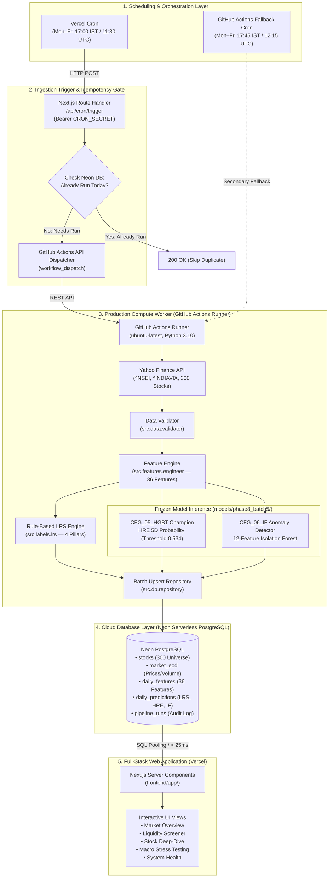
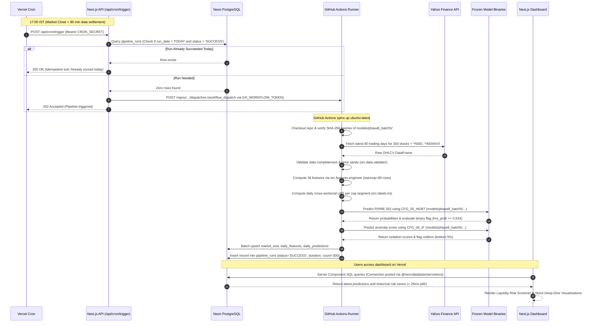
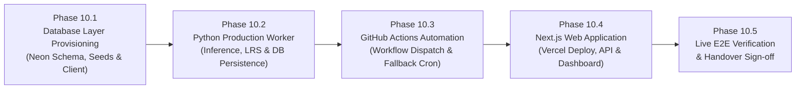

# FINAL PRODUCTION ARCHITECTURE & REPOSITORY HANDOFF SPECIFICATION
**Project:** ML-Based Liquidity and Trading-Risk Intelligence for Indian Equities  
**Document ID:** `PROD-ARCH-HANDOFF-20261116`  
**Date:** November 16, 2026  
**Audience:** Quantitative Research Team, Engineering Leads, and Codex Implementation Agent  
**Status:** COMPLETE & AUTHORITATIVE (STRICTLY READ-ONLY REVIEW — ZERO CODE MODIFICATIONS)  

---

## 1. Executive Architecture Overview

This document specifies the finalized, production-grade target architecture to transition the project from a frozen research repository (Phases 1–9) into an institutional decision-support platform delivering daily automated liquidity and trading-risk intelligence for **300 Indian equities** (NIFTY 100, NIFTY Midcap 150, and NIFTY Smallcap 50).

### Core Architectural Pillars
1. **Frontend Presentation Layer:** Next.js 14+ (App Router, React Server Components, TypeScript, Tailwind CSS) deployed on **Vercel Hobby Plan**.
2. **Persistent Relational Database:** **Neon Serverless PostgreSQL** providing auto-scaling, connection-pooled, branching-capable relational storage.
3. **Execution & Compute Worker:** A headless, idempotent Python production pipeline (`src/pipeline/daily_worker.py`) executing inside a **GitHub Actions Ubuntu Runner**.
4. **Scheduled Orchestration:** A precision dual-trigger mechanism: **Vercel Cron** hitting an authenticated Next.js API endpoint (`/api/cron/trigger`) that dispatches GitHub Actions via the GitHub REST API, backed by a secondary scheduled cron fallback in GitHub Actions.
5. **Frozen Machine Learning Core:** Absolute reuse of the frozen Phase 8 machine learning models (**CFG_05_HGBT** champion and **CFG_06_IF** anomaly detector) and the approved Phase 7 4-pillar rule-based Liquidity Risk Score (**LRS**) engine without retraining, refitting, or recalibrating.
6. **Zero Operational Cost:** Architected strictly to run at **₹0.00 / month ($0.00)** within permanent free-tier quotas (GitHub Actions 2,000 mins/mo, Neon 500 MB storage / 100 compute hrs/mo, Vercel Hobby serverless bandwidth, and Yahoo Finance public market data feeds).

---

## 2. Global Architecture Diagram



---

## 3. Component Responsibility Matrix

| Component | Repository Path | Architectural Layer | Operational Responsibility | Lifecycle Status |
| :--- | :--- | :--- | :--- | :---: |
| **Vercel Cron** | `frontend/vercel.json` | Orchestration | Fires scheduled POST trigger at 17:00 IST on trading days. | **PREVIOUSLY APPROVED** |
| **Trigger Route Handler** | `frontend/app/api/cron/trigger/route.ts` | API / Edge Gate | Authenticates trigger, checks NSE trading calendar, verifies idempotency in Neon, calls GitHub API. | **PREVIOUSLY APPROVED** |
| **GitHub Actions Runner** | `.github/workflows/daily_inference.yml` | CI/CD & Compute | Spins up Ubuntu environment, verifies model SHA-256 hashes, executes Python production worker. | **PREVIOUSLY APPROVED** |
| **Production ML Worker** | `src/pipeline/daily_worker.py` | Production Backend | Master orchestrator: Ingestion -> Validation -> Features -> LRS -> Model Inference -> Neon Upsert. | **PREVIOUSLY APPROVED** |
| **Production Health Check** | `src/pipeline/health_check.py` | Production Backend | Pre-run and post-run diagnostic module: data freshness, database reachability, model integrity. | **PREVIOUSLY APPROVED** |
| **Neon Connection Pool** | `src/db/connection.py` | Database Client | Thread-safe connection pool factory managing SSL connections to Neon with retry decorators. | **PREVIOUSLY APPROVED** |
| **Database Repository** | `src/db/repository.py` | Database Client | Idempotent batch upsert utilities using `psycopg2.extras.execute_values` with `ON CONFLICT DO UPDATE`. | **PREVIOUSLY APPROVED** |
| **Database Schema DDL** | `db/migrations/001_initial_schema.sql` | Relational Storage | DDL statements defining tables, primary keys, foreign keys, and indexes in Neon PostgreSQL. | **PREVIOUSLY APPROVED** |
| **Universe Seed Data** | `db/seeds/seed_universe.sql` | Relational Storage | SQL seed script populating 300 active equities (ISIN, sector, cap segment) from `configs/universe.json`. | **PREVIOUSLY APPROVED** |
| **HGBT Champion Binary** | `models/phase8_batch5/hist_gradient_boosting/` | Frozen Machine Learning | 36-feature serialized `model.joblib`. Generates forward 5-day HRE probability (`hre_prob`). | **IMPLEMENTED & FROZEN** |
| **Isolation Forest Binary** | `models/phase8_batch5/isolation_forest/` | Frozen Machine Learning | 12-feature serialized `model.joblib`. Generates unsupervised anomaly scores and outlier flags. | **IMPLEMENTED & FROZEN** |
| **Feature Engineering Engine** | `src/features/engineer.py` | Frozen Research Core | Computes 55 core features + 3 India VIX metrics with causal lookback protection. | **IMPLEMENTED & FROZEN** |
| **Rule-Based LRS Engine** | `src/labels/lrs.py` | Frozen Research Core | Computes 4-pillar composite LRS (0–100) using daily cross-sectional percentile rankings. | **IMPLEMENTED & FROZEN** |
| **Next.js Web Application** | `frontend/` | Presentation Layer | Full-stack React dashboard rendering market risk distribution, screener tables, and time series. | **PREVIOUSLY APPROVED** |
| **Legacy Streamlit App** | `app/` | Legacy UI Prototype | Kept 100% untouched and preserved in place for local offline reference until replacement is live. | **IMPLEMENTED & FROZEN** |

---

## 4. End-to-End Production Data Flow



---

## 5. Current Implementation & Readiness Matrix

| Architectural Layer | Target Path | Filesystem State | Completeness | Required Codex Implementation Action |
| :--- | :--- | :---: | :---: | :--- |
| **Automation** | `.github/workflows/` | Directory exists | **EMPTY (0 files)** | Create `daily_inference.yml` workflow definition. |
| **Database Migrations** | `db/migrations/` | Directory exists | **EMPTY (0 files)** | Create `001_initial_schema.sql` defining 5 core relational tables. |
| **Database Seeds** | `db/seeds/` | Directory exists | **EMPTY (0 files)** | Create `seed_universe.sql` to populate 300 active stocks. |
| **Frontend Root** | `frontend/` | Directory exists | **EMPTY (0 files)** | Initialize Next.js 14+ App Router project with Tailwind CSS. |
| **Python DB Client** | `src/db/` | Directory exists | **EMPTY (0 files)** | Create `__init__.py`, `connection.py`, and `repository.py`. |
| **Production Tests** | `tests/production/` | Directory exists | **EMPTY (0 files)** | Create `test_db_repository.py` and `test_daily_worker.py`. |
| **Production Worker** | `src/pipeline/daily_worker.py` | File missing | **INCOMPLETE** | Implement production runner importing feature engines and models. |
| **Pipeline Health Check** | `src/pipeline/health_check.py` | Scaffold exists (raises `NotImplementedError`) | **INCOMPLETE** | Implement diagnostic assertions (hashes, DB reachability, data freshness). |
| **Frozen ML Models** | `models/phase8_batch5/` | Fully populated | **100% COMPLETE & FROZEN** | Load in read-only mode via `joblib.load`. Checksums must match. |
| **Feature Engines** | `src/features/` | Fully populated | **100% COMPLETE & FROZEN** | Import directly into `daily_worker.py`. Zero modifications. |
| **LRS Rule Engine** | `src/labels/lrs.py` | Fully populated | **100% COMPLETE & FROZEN** | Import directly into `daily_worker.py`. Zero modifications. |
| **Universe Definition** | `configs/universe.json` | Fully populated | **100% COMPLETE & FROZEN** | Use as source of truth for database seed script. |
| **Legacy Streamlit App** | `app/` | Fully populated (11 files) | **PRESERVED UNTOUCHED** | Keep in place; do not delete or rename. |

---

## 6. Database and API Architecture

### 6.1 Relational Schema Specification (Neon PostgreSQL)

```sql
-- =============================================================================
-- 1. STOCKS DIMENSION TABLE (300 Active Equities)
-- =============================================================================
CREATE TABLE IF NOT EXISTS stocks (
    ticker VARCHAR(20) PRIMARY KEY,
    company_name VARCHAR(150) NOT NULL,
    cap_segment VARCHAR(10) NOT NULL CHECK (cap_segment IN ('large', 'mid', 'small')),
    sector VARCHAR(100),
    isin VARCHAR(20),
    is_active BOOLEAN DEFAULT TRUE,
    created_at TIMESTAMP WITH TIME ZONE DEFAULT NOW()
);

-- =============================================================================
-- 2. DAILY MARKET EOD TABLE (Prices & Volumes)
-- =============================================================================
CREATE TABLE IF NOT EXISTS market_eod (
    ticker VARCHAR(20) REFERENCES stocks(ticker),
    date DATE NOT NULL,
    open NUMERIC(10,2) NOT NULL,
    high NUMERIC(10,2) NOT NULL,
    low NUMERIC(10,2) NOT NULL,
    close NUMERIC(10,2) NOT NULL,
    volume BIGINT NOT NULL,
    turnover NUMERIC(18,2),
    created_at TIMESTAMP WITH TIME ZONE DEFAULT NOW(),
    PRIMARY KEY (ticker, date)
);

-- =============================================================================
-- 3. DAILY ENGINEERED FEATURES TABLE (36 Frozen Model Features)
-- =============================================================================
CREATE TABLE IF NOT EXISTS daily_features (
    ticker VARCHAR(20) REFERENCES stocks(ticker),
    date DATE NOT NULL,
    daily_return REAL, return_5d REAL, return_20d REAL, return_z20 REAL,
    abs_return REAL, price_rel_ma20 REAL, vol_5d REAL, vol_20d REAL,
    vol_ratio_5_20 REAL, downside_vol_20d REAL, max_drawdown_20d REAL,
    rsi_14 REAL, vol_of_vol REAL, log_volume REAL, volume_z20 REAL,
    amihud_ratio REAL, amihud_ma20 REAL, amihud_z20 REAL, log_turnover REAL,
    turnover_ratio REAL, low_volume_streak REAL, daily_range REAL,
    daily_range_ma20 REAL, range_z20 REAL, overnight_gap REAL,
    overnight_gap_abs REAL, cs_spread_est REAL, cs_spread_ma10 REAL,
    excess_return_1d REAL, rolling_beta_60d REAL, rolling_corr_60d REAL,
    relative_volume REAL, nifty_vol_20d REAL, nifty_return_20d REAL,
    vol_beta REAL, vix_close REAL,
    created_at TIMESTAMP WITH TIME ZONE DEFAULT NOW(),
    PRIMARY KEY (ticker, date)
);

-- =============================================================================
-- 4. DAILY PREDICTIONS & RISK INTELLIGENCE TABLE
-- =============================================================================
CREATE TABLE IF NOT EXISTS daily_predictions (
    ticker VARCHAR(20) REFERENCES stocks(ticker),
    date DATE NOT NULL,
    lrs_score REAL NOT NULL,                 -- Rule-based LRS (0.0 to 100.0)
    lrs_band VARCHAR(15) NOT NULL,           -- 'LOW', 'MODERATE', 'HIGH', 'VERY HIGH'
    lrs_90p_exceeded BOOLEAN NOT NULL,       -- True if exceeds segment 90th percentile threshold
    hre_prob REAL NOT NULL,                  -- Champion HGBT probability P(HRE 5D)
    hre_flag SMALLINT NOT NULL,              -- 1 if hre_prob >= 0.534 else 0
    isolation_score REAL NOT NULL,           -- Isolation Forest anomaly score
    is_anomaly BOOLEAN NOT NULL,             -- True if isolation_score indicates outlier
    model_version VARCHAR(50) NOT NULL,      -- 'CFG_05_HGBT_v1'
    created_at TIMESTAMP WITH TIME ZONE DEFAULT NOW(),
    PRIMARY KEY (ticker, date)
);

-- =============================================================================
-- 5. PIPELINE EXECUTION AUDIT LOG TABLE
-- =============================================================================
CREATE TABLE IF NOT EXISTS pipeline_runs (
    run_id SERIAL PRIMARY KEY,
    run_date DATE NOT NULL UNIQUE,
    triggered_by VARCHAR(50) NOT NULL,       -- 'vercel_cron' | 'manual' | 'gha_schedule'
    status VARCHAR(20) NOT NULL,             -- 'RUNNING' | 'SUCCESS' | 'FAILED'
    duration_seconds REAL,
    stocks_processed INTEGER,
    error_message TEXT,
    created_at TIMESTAMP WITH TIME ZONE DEFAULT NOW()
);

-- Composite Indexes for Sub-25ms Dashboard Querying
CREATE INDEX IF NOT EXISTS idx_predictions_date ON daily_predictions(date DESC);
CREATE INDEX IF NOT EXISTS idx_predictions_ticker_date ON daily_predictions(ticker, date DESC);
CREATE INDEX IF NOT EXISTS idx_market_eod_date ON market_eod(date DESC);
CREATE INDEX IF NOT EXISTS idx_features_date ON daily_features(date DESC);
```

### 6.2 Frontend Next.js API Endpoints

1. **`POST /api/cron/trigger`**  
   - **Auth:** `Authorization: Bearer <CRON_SECRET>`
   - **Logic:** Queries `pipeline_runs` for `CURRENT_DATE`. If already completed, returns `200 OK`. If not, sends `workflow_dispatch` POST request to GitHub Actions REST API with fine-grained PAT.
2. **`GET /api/predictions/latest`**  
   - **Auth:** Public / Read-Only
   - **Query:** Fast indexed join between `stocks` and `daily_predictions` for the latest available date. Serves the 300-row cross-sectional screener payload with HTTP Cache-Control headers.
3. **`GET /api/predictions/[ticker]`**  
   - **Auth:** Public / Read-Only
   - **Query:** Returns trailing 252-day time series of prices, LRS scores, HRE forward probabilities, and anomaly flags for an individual stock.
4. **`GET /api/events`**  
   - **Auth:** Public / Read-Only
   - **Query:** Serves historical event impact data (from Phase 9 event studies and macro stress profiles).
5. **`GET /api/health`**  
   - **Auth:** Public / Read-Only
   - **Query:** Returns database latency, latest scored trading date, and last 7 entries from `pipeline_runs`.

---

## 7. Deployment and Automation Design

### 7.1 GitHub Actions Workflow (`.github/workflows/daily_inference.yml`)
* **Runner Image:** `ubuntu-latest`
* **Python Runtime:** Python `3.10` with pip caching.
* **Triggers:**
  1. `workflow_dispatch` (Manual trigger with inputs `run_date` and `force_recompute`).
  2. `repository_dispatch` (Programmatic trigger from Vercel Cron).
  3. `schedule`: `[cron: '45 11 * * 1-5']` (17:15 IST secondary fallback).
* **Environment Secrets Required:**
  - `NEON_DATABASE_URL`: Connection string to Neon PostgreSQL (`sslmode=require`).
  - `PIPELINE_AUTH_TOKEN`: Secret token matching Vercel's trigger request.

### 7.2 Vercel Deployment Configuration (`frontend/vercel.json`)
```json
{
  "framework": "nextjs",
  "crons": [
    {
      "path": "/api/cron/trigger",
      "schedule": "30 11 * * 1-5"
    }
  ]
}
```
* Note: `30 11 * * 1-5` corresponds to 11:30 UTC = 17:00 IST (Indian Standard Time) on Monday through Friday.

---

## 8. Security and Zero-Cost Architecture Verification

| Component | Platform | Free-Tier Allowance | Expected Project Consumption | Utilization Rate | Monthly Cost | Cost Risk / Mitigation |
| :--- | :--- | :--- | :--- | :---: | :---: | :--- |
| **Compute Worker** | GitHub Actions | 2,000 runner minutes/mo | ~3.5 min/day × 22 trading days = **~77 min/mo** | **~3.8%** | **$0.00** | **Negligible.** Runner minute usage is < 4% of free quota. Fallback: local execution. |
| **Relational Database** | Neon PostgreSQL | 500 MB persistent storage<br>100 compute hours/mo | 300 stocks/day = ~35 KB/day<br>Annual volume = **~9 MB/year** | **< 2%** in Year 1 | **$0.00** | Compute auto-suspends after 5 min of inactivity (< 1 hr/mo active compute). Zero risk. |
| **Web Hosting & Cron** | Vercel Hobby | Up to 2 Cron Jobs<br>100 GB Bandwidth/mo | 1 daily cron trigger<br>< 2 GB bandwidth/mo | **50%** of cron limit<br>**< 2%** bandwidth | **$0.00** | 1 cron job used out of 2 allowed on Hobby plan. Serverless invocations well within limits. |
| **Market Data Feed** | Yahoo Finance | Public open-access API | 300 stocks + 3 indices once daily | Standard public rate | **$0.00** | Batch size = 20 with 1.0s delay prevents HTTP 429 rate limits. |

### Security Protocols
* **Zero Credential Exposure:** Database URLs and API tokens must never be committed to Git. All secrets live in Vercel Environment Variables and GitHub Actions Repository Secrets.
* **SSL Enforcement:** All PostgreSQL connections strictly mandate TLS 1.3 (`sslmode=require`).
* **Endpoint Protection:** The Vercel Cron trigger route rejects any incoming request missing the header `Authorization: Bearer <CRON_SECRET>`.

---

## 9. Phased Implementation Roadmap for Codex

The transition to production is divided into **5 sequential phases**. Each phase is fully decoupled, verifiable, and non-destructive:



---

### Phase 10.1 — Database Layer Provisioning & Python DB Client
* **Objective:** Establish the relational storage layer in Neon PostgreSQL and implement the Python database access client.
* **Starting Justification:** Phase 10.1 is the **mandatory first step** because both the Python worker (to persist daily inferences) and the Next.js frontend (to serve dashboard queries) depend strictly on the relational schema.
* **Components / Files Created:**
  - `db/migrations/001_initial_schema.sql` (DDL for 5 tables)
  - `db/seeds/seed_universe.sql` (Seed script for 300 equities from `configs/universe.json`)
  - `src/db/__init__.py`
  - `src/db/connection.py` (Neon engine factory with SSL and retry logic)
  - `src/db/repository.py` (Idempotent batch-upsert module)
  - `tests/production/test_db_repository.py` (Unit tests for connection and upsert idempotency)
* **Dependencies:** Free Neon PostgreSQL instance provisioned by user (`NEON_DATABASE_URL`), `psycopg2-binary>=2.9.9`, `sqlalchemy>=2.0.0`.
* **Validation & Testing:** Run `pytest tests/production/test_db_repository.py`. Must confirm successful connection, table creation, seed validation (300 stocks), and upsert idempotency (running twice produces identical row counts).

---

### Phase 10.2 — Python Production ML Worker Implementation
* **Objective:** Build the end-to-end production daily inference script that executes post-market scoring and writes predictions to Neon.
* **Components / Files Created:**
  - `src/pipeline/daily_worker.py` (Master production runner)
  - `src/pipeline/health_check.py` (Replaces scaffold stub with concrete pre-run diagnostic checks)
  - `src/pipeline/notifier.py` (Error alerting utility)
  - `tests/production/test_daily_worker.py` (End-to-end integration test with mock data)
  - `tests/production/test_inference_fidelity.py` (Verifies bit-parity with frozen Phase 8 holdout outputs)
* **Dependencies:** Completed Phase 10.1 database layer, frozen `models/phase8_batch5/`, `src/features/engineer.py`, `src/labels/lrs.py`.
* **Validation & Testing:** Run dry-run inference on a historical date (`python -m src.pipeline.daily_worker --date 2026-10-23 --dry-run`). Verify that output `hre_prob`, `lrs_score`, and `isolation_score` match Phase 8 holdout parquets to 4 decimal places.

---

### Phase 10.3 — GitHub Actions Automation & Verification
* **Objective:** Configure and test automated workflow execution in GitHub Actions.
* **Components / Files Created:**
  - `.github/workflows/daily_inference.yml`
  - `.github/workflows/production_tests.yml`
* **Dependencies:** Completed Phase 10.2 worker, GitHub Repository Secrets (`NEON_DATABASE_URL`).
* **Validation & Testing:** Trigger manual execution via `workflow_dispatch` in the GitHub Actions console. Confirm the runner finishes in < 4 minutes with exit code 0, and verify a new row in Neon's `pipeline_runs` table with `status = 'SUCCESS'`.

---

### Phase 10.4 — Full-Stack Next.js Application on Vercel
* **Objective:** Initialize and build the full-stack Next.js web application deployed to Vercel.
* **Components / Files Created:**
  - Initialize Next.js in `frontend/` (`package.json`, `tsconfig.json`, `tailwind.config.ts`)
  - `frontend/vercel.json` (Vercel Cron definition)
  - `frontend/lib/db.ts` (Neon Serverless SQL client)
  - `frontend/lib/queries.ts` (Fast indexed SQL queries)
  - `frontend/app/api/cron/trigger/route.ts` (Vercel Cron gatekeeper)
  - `frontend/app/api/predictions/latest/route.ts`
  - `frontend/app/(dashboard)/page.tsx` (Market Overview)
  - `frontend/app/(dashboard)/screener/page.tsx` (Liquidity Screener)
  - `frontend/app/(dashboard)/stock/[ticker]/page.tsx` (Stock Deep-Dive)
* **Dependencies:** Completed Phase 10.1 database populated with seed and historical predictions, Vercel account, GitHub PAT (`GH_WORKFLOW_TOKEN`).
* **Validation & Testing:** Run local Next.js dev server (`npm run dev`). Verify all dashboard pages render data from Neon in < 100ms. Deploy to Vercel and verify live SSL build.

---

### Phase 10.5 — End-to-End Live Verification & Streamlit Review
* **Objective:** Verify live autonomous trigger from Vercel to GitHub Actions and review the Streamlit application disposition.
* **Components / Files Involved:** Live Vercel Cron trigger, live GitHub Actions run, live database records, `app/` directory.
* **Validation & Testing:** Trigger `/api/cron/trigger` via authenticated curl. Confirm complete round-trip: Vercel -> GitHub Actions -> Python Worker -> Neon DB -> Dashboard updated. Present Streamlit deprecation review to user.

---

## 10. Risks, Dependencies, and Unresolved Technical Choices

| Item | Category | Status | Technical Detail & Recommendation |
| :--- | :--- | :---: | :--- |
| **Python Database Driver** | Dependency | **UNRESOLVED** | Choice between `psycopg2-binary` (synchronous, robust, standard) vs `asyncpg` (asynchronous).<br>**Recommendation:** Use `psycopg2-binary>=2.9.9` with `SQLAlchemy>=2.0.0` engine. The production worker is batch-oriented and sequential; synchronous batch upserts (`execute_values`) are simpler, faster to test, and have zero asyncio overhead. |
| **Next.js SQL Access Method** | Architecture | **UNRESOLVED** | Choice between `@neondatabase/serverless` (HTTP fetch / WebSocket driver) vs standard `pg` connection pool.<br>**Recommendation:** Use `@neondatabase/serverless`. It natively works across Vercel Edge and Node.js Serverless runtimes without persistent TCP socket exhaustion. |
| **Streamlit App Disposition** | Lifecycle | **PREVIOUSLY APPROVED** | The existing `app/` directory remains **100% untouched in its current location** during Phase 10.1–10.4. Any decision to archive or remove it is strictly deferred until Phase 10.5 after the Next.js app is live. |
| **Market Data Rate Limiting** | Operational Risk | **PREVIOUSLY APPROVED** | Yahoo Finance API rate limits (HTTP 429). Mitigated by sequential chunking (20 tickers per batch with 1.0s delay and exponential backoff) specified in `configs/pipeline_config.yaml`. |

---

## 11. Exact First Implementation Task for Codex (Phase 10.1)

When beginning production implementation in a fresh session with Codex, use the following exact instruction:

```text
# CODEX INSTRUCTION: BEGIN PHASE 10.1 — DATABASE LAYER PROVISIONING

Project: ML-Based Liquidity and Trading-Risk Intelligence for Indian Equities
Authorized Scope: Phase 10.1 (Database Layer Provisioning & Python DB Client)

Context:
The repository structure is prepared (empty db/migrations/, db/seeds/, src/db/, tests/production/ exist).
All research code, frozen models (models/phase8_batch5/), and data parquets are FROZEN and must remain untouched.
The existing Streamlit app/ directory must remain untouched.

Your Task:
1. Create `db/migrations/001_initial_schema.sql` implementing the 5 relational tables:
   - `stocks` (ticker PK, company_name, cap_segment, sector, isin, is_active)
   - `market_eod` (ticker, date PK, open, high, low, close, volume, turnover)
   - `daily_features` (ticker, date PK, 36 frozen model feature columns)
   - `daily_predictions` (ticker, date PK, lrs_score, lrs_band, lrs_90p_exceeded, hre_prob, hre_flag, isolation_score, is_anomaly, model_version)
   - `pipeline_runs` (run_id SERIAL PK, run_date UNIQUE, triggered_by, status, duration_seconds, stocks_processed, error_message)
   - Create composite indexes on date and ticker for sub-25ms dashboard querying.

2. Create `db/seeds/seed_universe.sql` parsing the 300 equities from `configs/universe.json`.

3. Implement `src/db/__init__.py`, `src/db/connection.py`, and `src/db/repository.py`:
   - `connection.py`: Thread-safe engine reading `NEON_DATABASE_URL` with `sslmode=require` and retry logic.
   - `repository.py`: Idempotent batch-upsert functions using `psycopg2.extras.execute_values` with `ON CONFLICT DO UPDATE`.

4. Implement `tests/production/test_db_repository.py` validating connection, migration execution, seed verification (300 stocks), and upsert idempotency.

5. Update `requirements.txt` strictly adding:
   psycopg2-binary>=2.9.9
   sqlalchemy>=2.0.0

Execute only Phase 10.1. Do not begin Phase 10.2. Run pytest on tests/production/ to verify.
```

---

## 12. Concise Handoff Summary for Fresh Chat

```text
================================================================================
ML-BASED LIQUIDITY AND TRADING-RISK INTELLIGENCE FOR INDIAN EQUITIES
PRODUCTION ARCHITECTURE HANDOFF SUMMARY (READY FOR IMPLEMENTATION)
================================================================================

1. REPOSITORY BASELINE:
   - Phases 1–9 are COMPLETE, AUDITED, and FROZEN.
   - All 119 unit/regression tests are PASSING.
   - Empty production directories exist: .github/workflows/, db/migrations/, db/seeds/, frontend/, src/db/, tests/production/.
   - Research models (models/phase8_batch5/), datasets (data/), and notebooks (notebooks/) are read-only.
   - Legacy Streamlit app/ is preserved untouched in place.

2. TARGET ARCHITECTURE:
   - Frontend: Next.js 14+ (App Router) on Vercel Hobby ($0/mo).
   - Database: Neon Serverless PostgreSQL ($0/mo, 500 MB storage, auto-suspend).
   - Compute: GitHub Actions Ubuntu Runner (Python 3.10, ~77 min/mo of 2,000 free mins).
   - Orchestration: Vercel Cron (17:00 IST) -> Next.js /api/cron/trigger -> GitHub API dispatch.
   - Core Models: CFG_05_HGBT (36 features, threshold 0.534), CFG_06_IF (12 features), 4-Pillar LRS.

3. IMMEDIATE NEXT ACTION (PHASE 10.1):
   - Provision free Neon PostgreSQL database to obtain NEON_DATABASE_URL.
   - Create db/migrations/001_initial_schema.sql and db/seeds/seed_universe.sql.
   - Implement src/db/connection.py and src/db/repository.py.
   - Run tests/production/test_db_repository.py to confirm 100% database connectivity and upsert idempotency.
================================================================================
```

---

*This document is saved as `reports/production_architecture_final_handoff.md`.*  
*Zero implementation code has been modified. Ready for Phase 10.1 execution upon user authorization.*
